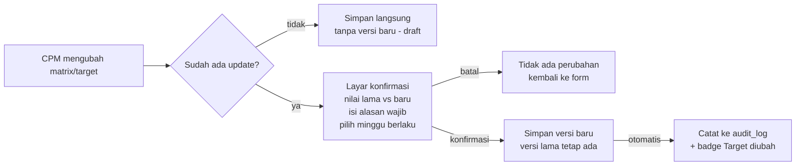

# FSD — POC Monitoring Web App

9 Nov 2026 · Iqbal Syams

Versi online (bisa dikomentari): https://claude.ai/artifact/RvN7x3UcqycH1J66jNio7d

## 1. Latar belakang & tujuan

Aplikasi ini menggantikan sheet "POC Monitoring" di Excel dengan web app yang mencatat setiap perubahan secara permanen dan menghitung achievement dari angka, bukan dari teks bebas.

Masalah di tracker sekarang:

- **Tidak ada jejak perubahan.** Siapa pun bisa mengubah matrix, target, atau revenue tanpa catatan siapa, kapan, dan kenapa.
- **Score ditulis sebagai teks bebas** ("7/8 alert \*100 = 100%", "37.0 → 34.1 (↓7.8%, Week 4)"). Format tiap baris berbeda, tidak bisa dihitung ulang, dan rawan salah hitung (7/8 tertulis 100%, seharusnya 87,5%).
- **Hanya menyimpan kondisi terakhir.** Riwayat per minggu hilang, kecuali ditulis manual di dalam sel.
- **Achievement diisi manual**, tidak terkait langsung dengan target.

Tujuan:

1. Setiap user login dengan akun sendiri, sehingga setiap aksi bisa ditelusuri ke orangnya.
2. POC dan matrix/target-nya tercatat terstruktur, dengan update mingguan berupa angka atau penilaian kualitatif.
3. Perubahan matrix/target wajib dikonfirmasi dengan alasan, dan versi lama tetap tersimpan.
4. Audit trail lengkap dan tidak bisa diubah, termasuk oleh admin.
5. Tampilan lebih rapi daripada Excel: daftar POC, detail per POC, dan grafik tren per minggu.

## 2. Ruang lingkup

Fase 1 fokus menggantikan Excel satu banding satu dan menambahkan audit trail. Integrasi lain ditunda.

| Masuk fase 1 | Tidak masuk fase 1 |
| --- | --- |
| Login email + password (akun dibuat admin) | Login Google / SSO |
| CRUD POC (customer, CPM, status, tanggal, revenue, target closed) | Tarik data otomatis dari Metabase |
| Matrix per POC (tidak dibatasi 2), numerik atau kualitatif | Approval berjenjang untuk perubahan |
| Update mingguan per matrix + catatan | Notifikasi email / Slack |
| Versi matrix + konfirmasi wajib dengan alasan | Lampiran file (foto, PDF) |
| Audit trail semua perubahan, tidak bisa dihapus | Aplikasi mobile native |
| Dashboard ringkas + grafik tren per POC | Export ke PPT (deck PoC tetap dibuat terpisah) |
| Export ke Excel/CSV | |
| Import data awal dari Excel | |

## 3. Peran & hak akses

Pengguna aplikasi hanya CPM. Ada dua peran: CPM, dan Admin (CPM yang juga mengelola akun). Semua CPM bisa melihat semua POC, termasuk potensi revenue, tetapi hanya CPM pemilik POC dan Admin yang bisa mengubahnya.

| Aksi | Admin | CPM |
| --- | --- | --- |
| Lihat daftar & detail semua POC, termasuk potensi revenue | Ya | Ya |
| Lihat audit trail | Ya | Ya |
| Buat POC baru | Ya | Ya (otomatis jadi CPM-nya) |
| Edit info POC & status | Ya | Hanya POC miliknya |
| Ubah matrix / target (wajib konfirmasi + alasan) | Ya | Hanya POC miliknya |
| Input update mingguan | Ya | Hanya POC miliknya |
| Arsipkan POC (tidak ada hapus permanen) | Ya | Tidak |
| Kelola akun CPM (buat akun, set/reset password, nonaktifkan) | Ya | Tidak |
| Pindahkan POC ke CPM lain | Ya | Tidak |

Aturan akun:

- Admin membuat akun dengan email + password awal. User **wajib mengganti password saat login pertama**, supaya password yang Anda bagikan tidak terus dipakai dan audit trail tetap bisa dipercaya sebagai "orang ini yang melakukan".
- Password disimpan dalam bentuk hash (bcrypt/argon2), tidak pernah bisa dilihat admin.
- User yang keluar dinonaktifkan, tidak dihapus, supaya namanya tetap muncul di audit trail.

Akun awal (dibuat saat go-live):

| Nama | Email | Peran | Keterangan |
| --- | --- | --- | --- |
| Iqbal Syams | iqbal.syams@mceasy.co.id | Admin | CPM, pengelola akun utama |
| Rizka Nugroho | rizka.nugroho@mceasy.co.id | Admin | Head of Activation, admin cadangan |
| Rizki Hikmawan | rizki.hikmawan@mceasy.co.id | CPM | |
| Mohammad Rizal | mohammad.rizal@mceasy.co.id | CPM | |
| Raditya Gilang | raditya.gilang@mceasy.co.id | CPM | |

## 4. Kebutuhan fungsional

### 4.1 Login

- **FR-01** Login dengan email + password. Sesi berakhir setelah 8 jam tidak aktif.
- **FR-02** Wajib ganti password di login pertama dan setelah direset admin. Minimal 8 karakter.
- **FR-03** Login berhasil dan login gagal dicatat di audit trail. Akun dikunci 15 menit setelah 5 kali gagal berturut-turut.

### 4.2 Daftar POC (halaman utama)

- **FR-10** Tabel POC dengan kolom yang sama seperti Excel: Customer, CPM, Status, POC Start, Potensi Revenue, ringkasan matrix, Score terakhir, Achievement, Target Closed.
- **FR-11** Filter berdasarkan CPM, Status, Achievement. Pencarian nama customer. Urutkan per kolom.
- **FR-12** Kartu ringkasan di atas tabel: jumlah POC per status, total potensi revenue POC aktif, dan jumlah POC yang update terakhirnya lebih dari 7 hari lalu.
- **FR-13** Penanda "belum update" untuk POC berstatus Running yang tidak punya update mingguan lebih dari 7 hari.

### 4.3 Data POC

| Field | Tipe | Wajib | Keterangan |
| --- | --- | --- | --- |
| Customer name | Teks | Ya | contoh "GTL - Supporting Pre Deals" |
| CPM | Pilih user | Ya | default = pembuat |
| Status | Pilihan | Ya | Upcoming, Running, Done, Cancelled |
| POC start date | Tanggal | Saat status Running | |
| POC end date (rencana) | Tanggal | Tidak | menentukan jumlah minggu |
| Target closed | Tanggal | Ya | |
| Potensi revenue (Rp) | Angka | Ya | perubahan nilai ikut dicatat |
| Produk / scope | Teks | Tidak | contoh FMS, TrackVision, RFID, ADAS |
| Achievement | Pilihan | Otomatis | Work in Progress, Achieved, Partially Achieved, Not Achieved |
| Catatan | Teks panjang | Tidak | |

Status "Weekly Checkin" di Excel digabung ke "Running", karena update mingguan sekarang jadi fitur tersendiri dan tidak perlu jadi status.

### 4.4 Matrix & target (berversi)

- **FR-20** Satu POC bisa punya 1 sampai N matrix (tidak dikunci ke 2 kolom seperti Excel).
- **FR-21** Setiap matrix punya: nama, deskripsi/cara ukur, tipe perhitungan, satuan, baseline (jika ada), target (angka, atau teks untuk tipe kualitatif), dan arah (makin tinggi makin baik / makin rendah makin baik).
- **FR-22** Empat tipe matrix. CPM bebas menamai dan mendefinisikan isi matrix sesuai POC-nya, lalu memilih tipe numerik (dihitung otomatis) atau kualitatif (dinilai manual):

| Tipe | Input mingguan | Rumus score | Contoh di Excel |
| --- | --- | --- | --- |
| Rasio | pembilang, penyebut | pembilang ÷ penyebut × 100% | 12/12 alert terdeteksi, target ≥80% |
| Penurunan dari baseline | nilai aktual | (baseline − aktual) ÷ baseline × 100% | alert/100 km 37,0 → 34,1, target ≥10% |
| Nilai langsung | nilai aktual | nilai itu sendiri | false alarm rate, target <15% |
| Kualitatif | teks hasil + status Met / Partial / Not met | tidak ada score; status dipilih CPM | customer puas dengan tampilan dashboard |

- **FR-23** Matrix yang sudah disimpan **tidak bisa diedit langsung**. Mengubah nama, rumus, baseline, atau target membuat **versi baru**. Versi lama tetap tersimpan dan tetap terkait ke update mingguan yang sudah dibuat.
- **FR-24** Sebelum menyimpan versi baru, muncul layar konfirmasi berisi: perbandingan nilai lama vs baru per field, kolom **alasan perubahan (wajib, minimal 20 karakter)**, dan keterangan "berlaku mulai minggu ke-N" (otomatis minggu setelah update terakhir). User mencentang pernyataan untuk konfirmasi.
- **FR-25** Matrix bisa dinonaktifkan (dengan alasan), tidak bisa dihapus.
- **FR-26** Selama POC berstatus Upcoming dan belum ada update mingguan, matrix boleh diubah tanpa konfirmasi dan alasan (masih tahap draft). Perubahan tetap disimpan sebagai versi baru karena matrix_version append-only. Konfirmasi wajib berlaku setelah update mingguan pertama masuk.

### 4.5 Update mingguan

- **FR-30** Periode update ditentukan CPM. Saat membuat update, CPM mengisi tanggal mulai dan selesai periode; sistem mengusulkan 7 hari setelah periode sebelumnya, dan nomor minggu bertambah otomatis. Periode dalam satu POC tidak boleh tumpang tindih.
- **FR-31** Form update menampilkan semua matrix aktif beserta versinya yang berlaku. Untuk matrix numerik, user mengisi angka dan sistem menghitung score serta Met / Not met. Untuk matrix kualitatif, user mengisi teks hasil dan memilih Met / Partial / Not met.
- **FR-32** Kolom teks per update: progress, kendala, next action.
- **FR-33** Update yang sudah di-submit bisa dikoreksi, tetapi wajib alasan, dan nilai sebelumnya tersimpan di audit trail.
- **FR-34** Achievement POC dihitung otomatis dari update terakhir: semua matrix Met = Achieved, ada yang Met atau Partial = Partially Achieved, tidak ada = Not Achieved, belum ada update = Work in Progress. CPM bisa override dengan alasan wajib, dan override itu ditandai di tampilan.

### 4.6 Halaman detail POC

- **FR-40** Header: info POC, status, achievement, dan tombol aksi sesuai hak akses.
- **FR-41** Tab Matrix: daftar matrix aktif + riwayat versi (lihat versi 1, 2, 3 dan alasan perubahannya).
- **FR-42** Tab Update mingguan: tabel minggu × matrix berisi score, plus grafik garis tren per matrix numerik dengan garis target. Matrix kualitatif ditampilkan sebagai riwayat status per periode. Saat versi matrix berganti, grafik menandai minggu pergantiannya.
- **FR-43** Tab Riwayat: audit trail khusus POC ini, terbaru di atas.

### 4.7 Audit trail

- **FR-50** Halaman audit global (semua POC), dengan filter user, POC, jenis aksi, dan rentang tanggal.
- **FR-51** Setiap baris menampilkan: waktu (WIB), user, aksi, objek, field yang berubah, nilai lama → nilai baru, dan alasan.
- **FR-52** Bisa diekspor ke CSV.

### 4.8 Export & import

- **FR-60** Export daftar POC dan update mingguan ke Excel/CSV, untuk bahan deck PoC.
- **FR-61** Import satu kali dari Excel lama (lihat bagian 9).

### 4.9 Status deal (ditambahkan 9 Nov 2026)

- **FR-70** Status POC menunjukkan progres POC (Upcoming, Running, On Hold, Done, Cancelled). Status deal terpisah dan menunjukkan hasil komersial: Awaiting Deal, Deal Won, Deal Lost, atau kosong jika belum relevan.
- **FR-71** CPM pemilik POC dan Admin bisa mengisi status deal kapan saja. Deal Won dan Deal Lost wajib tanggal keputusan dan alasan (minimal 10 karakter). Semua perubahan tercatat di audit trail.
- **FR-72** Daftar POC punya kolom dan filter Status deal, termasuk filter "Belum diisi".

### 4.10 Dashboard management (ditambahkan 9 Nov 2026)

Halaman /dashboard untuk dibuka CPM/Admin saat meeting management. Semua angka dihitung langsung dari database, tanpa arsip.

- **FR-80** Posisi POC saat ini: jumlah dan potensi revenue per status POC. Setiap kotak membuka daftar POC yang sudah terfilter.
- **FR-81** Konversi: POC Done, lalu Achieved, lalu Achieved dan Deal Won, ditambah tabel achievement × status deal. Persentase hanya tampil jika minimal 10 POC selesai; di bawah itu ditampilkan angka mentah ("x dari y").
- **FR-82** Potensi revenue per hasil deal: Deal Won, Awaiting Deal, Done tanpa status deal, masih berjalan, Deal Lost.
- **FR-83** Perlu perhatian: target closed sudah lewat, Running tanpa update lebih dari 7 hari, Done tanpa status deal, target matrix diubah dalam 30 hari terakhir.
- **FR-84** Per CPM: jumlah Running, Upcoming/On Hold, Done, Deal Won, Awaiting, Deal Lost, dan potensi revenue aktif.

## 5. Alur utama

### 5.1 Membuat POC

1. CPM klik "POC baru", isi data POC (bagian 4.3). Status awal Upcoming.
2. CPM menambah matrix: nama, tipe (numerik atau kualitatif), baseline, target. Selama belum ada update mingguan, matrix masih bisa diubah bebas.
3. Saat POC dimulai, CPM mengubah status ke Running dan mengisi POC start date. Nomor minggu mulai dihitung.

### 5.2 Update mingguan

1. CPM membuka POC, klik "Update minggu ke-N". Form menampilkan semua matrix aktif dengan versi yang berlaku.
2. CPM menentukan tanggal periode, lalu mengisi angka atau hasil kualitatif per matrix, plus progress, kendala, dan next action.
3. Sistem menghitung score dan Met/Not met, lalu memperbarui achievement POC.
4. Kalau ada koreksi setelah submit, CPM wajib mengisi alasan. Nilai lama tersimpan di audit trail.

### 5.3 Mengubah matrix / target

Setelah konfirmasi, update minggu berikutnya memakai versi baru, sedangkan minggu sebelumnya tetap dinilai dengan versi lama.

## 6. Data model

Intinya ada tujuh tabel. Matrix dipisah menjadi "matrix" (identitas) dan "matrix_version" (isi yang berversi), sehingga setiap nilai mingguan menunjuk ke versi target yang berlaku saat itu.

| Tabel | Kolom utama | Catatan |
| --- | --- | --- |
| users | id, email, name, role (admin/cpm), password_hash, must_change_password, is_active, created_at | tidak pernah dihapus |
| poc | id, customer_name, cpm_id → users, status, start_date, end_date, target_closed_date, potential_revenue, scope, achievement, achievement_override_reason, notes, is_archived, created_by, created_at, updated_at | |
| matrix | id, poc_id → poc, order_no, is_active, created_at | identitas matrix (Matrix 1, Matrix 2, ...) |
| matrix_version | id, matrix_id → matrix, version_no, name, description, calc_type (ratio/reduction/value/qualitative), unit, baseline, target_value, target_operator (≥, ≤, >, <), target_text, effective_from_week, change_reason, created_by, created_at | **append-only**, tidak ada UPDATE |
| weekly_update | id, poc_id → poc, week_no, period_start, period_end, progress, issues, next_action, submitted_by, submitted_at | unik per (poc_id, week_no) |
| weekly_value | id, weekly_update_id → weekly_update, matrix_version_id → matrix_version, numerator, denominator, actual_value, result_text, status (met/partial/not_met), score | untuk tipe numerik, score dan status dihitung server |
| audit_log | id, occurred_at, user_id, action, entity_type, entity_id, poc_id, before (JSON), after (JSON), reason, ip_address | **append-only**, lihat bagian 7 |

Waktu disimpan dalam UTC dan ditampilkan dalam WIB (GMT+7).

## 7. Aturan audit trail

Audit trail hanya bisa ditambah, tidak bisa diubah atau dihapus oleh siapa pun lewat aplikasi, termasuk Admin. Tanpa aturan ini, log tidak bisa dijadikan bukti.

Cara menjaminnya:

- Pencatatan audit dilakukan di **database (trigger)**, bukan hanya di kode aplikasi, sehingga perubahan yang tidak lewat UI pun tetap tercatat.
- User database yang dipakai aplikasi hanya punya hak INSERT dan SELECT pada tabel audit_log dan matrix_version, tanpa UPDATE/DELETE.
- Tidak ada fitur "hapus" di aplikasi. Yang ada hanya arsipkan atau nonaktifkan, dan aksi itu sendiri ikut tercatat.

Aksi yang dicatat:

| Aksi | Alasan wajib? | Yang disimpan |
| --- | --- | --- |
| Login berhasil / gagal, ganti password | Tidak | user, waktu, IP (tanpa password) |
| Buat POC | Tidak | seluruh data awal |
| Edit info POC (status, tanggal, revenue, CPM) | Tidak, kecuali revenue dan target closed | field yang berubah, lama → baru |
| Buat matrix / versi baru matrix | Ya (setelah update pertama) | versi lama dan baru lengkap |
| Nonaktifkan matrix | Ya | versi terakhir |
| Submit update mingguan | Tidak | semua nilai |
| Koreksi update mingguan | Ya | nilai lama → baru |
| Override achievement | Ya | nilai otomatis → nilai override |
| Arsipkan POC, pindah CPM | Ya | |
| Buat / reset / nonaktifkan user | Tidak | user target, role |

Mengenai "self-confirm + alasan" yang Anda pilih: ini mencegah perubahan tidak sengaja dan memaksa ada penjelasan, tetapi **tidak mencegah CPM menurunkan targetnya sendiri**. Sebagai pengaman minimal, setiap versi baru matrix diberi badge "Target diubah" di daftar POC dan dashboard, sehingga perubahan terlihat oleh semua orang, tidak hanya tersimpan di log.

## 8. Non-fungsional & stack

Aplikasi ini internal. Hosting dan domain disediakan DevOps McEasy, sehingga stack cukup memakai software open-source gratis yang dikemas dalam Docker: **Next.js + PostgreSQL**. Tidak ada layanan cloud pihak ketiga, jadi tidak ada batas kuota, risiko pause, atau data customer di luar infrastruktur McEasy.

| Lapisan | Pilihan | Alasan |
| --- | --- | --- |
| Aplikasi | Next.js (TypeScript), frontend + backend dalam satu codebase | satu container, cukup satu deploy |
| UI | Tailwind CSS + shadcn/ui | tampilan rapi tanpa desain dari nol |
| Database | PostgreSQL 16 atau lebih baru | trigger untuk audit, role database terpisah |
| Akses database & migrasi | SQL langsung (node-postgres) + file migrasi .sql berurutan | trigger audit dan hak akses memang harus ditulis dalam SQL, jadi skema cukup satu sumber |
| Auth | Session cookie + hash bcrypt, dibuat sendiri | tidak bergantung pada layanan login eksternal |
| Grafik | Recharts | |
| Export Excel | exceljs | lisensi MIT |
| Packaging | Dockerfile (Next.js standalone) | dev lokal tanpa Docker (PostgreSQL embedded); production lewat image Docker |

Development dan uji coba berjalan penuh di laptop dengan perintah npm run dev (PostgreSQL embedded), tanpa server dan tanpa Docker. Selama masih lokal, hanya Anda yang bisa membuka aplikasinya; CPM lain baru bisa login setelah di-deploy. Saat siap deploy, informasi berikut diserahkan ke DevOps, dan detail servernya mereka yang menentukan:

| Kebutuhan | Detail |
| --- | --- |
| Runtime | image Docker siap pakai; kebutuhan sekitar 1 vCPU / 1 GB RAM |
| PostgreSQL | instance terkelola atau container, dengan **dua role**: owner untuk migrasi, dan app_user tanpa hak UPDATE/DELETE pada audit_log dan matrix_version |
| Domain & TLS | subdomain internal (misal poc-tracker.mceasy.co.id), HTTPS |
| Akses jaringan | diputuskan DevOps (hanya jaringan kantor/VPN, atau publik dengan login) |
| Backup | dump Postgres harian, retensi minimal 30 hari, uji restore sekali sebelum go-live |
| Secret | tempat menyimpan DATABASE_URL dan SESSION_SECRET (bukan di repo) |
| CI/CD | repo Git perusahaan + pipeline build image |

Non-fungsional:

- HTTPS wajib, walaupun hanya diakses dari jaringan internal.
- Tampilan responsif, bisa dibuka di laptop dan HP untuk update cepat. Selalu tema terang sesuai McEasy Design System, tidak mengikuti mode gelap OS.
- Halaman daftar terbuka dalam kurang dari 2 detik untuk 500 POC.
- Semua waktu disimpan dalam UTC dan ditampilkan dalam WIB.

## 9. Migrasi dari Excel

Data Excel dimigrasikan satu kali, dan kolom Score yang berupa teks bebas harus diterjemahkan manual ke angka terstruktur. Bagian ini tidak bisa diotomasi sepenuhnya.

1. Kolom Customer, CPM, Status, POC Start, Total Revenue (sebagai potensi revenue), Target Closed diimpor otomatis lewat script.
2. Matrix 1 dan Matrix 2 diimpor sebagai matrix versi 1. Tipe (numerik atau kualitatif), baseline, dan target dipisahkan dari teksnya oleh CPM masing-masing (perkiraan 10–15 menit per POC).
3. Score yang sudah ada diimpor sebagai update mingguan terakhir yang diketahui, ditandai "hasil migrasi".
4. Riwayat sebelum migrasi tidak bisa direkonstruksi. Audit trail dimulai dari tanggal go-live.
5. File Excel lama disimpan read-only sebagai arsip.

Saat migrasi, nilai yang tidak konsisten harus diputuskan oleh CPM, contohnya DHL Matrix 1: "7/8 alert \*100 = 100%". Hasil hitungnya 87,5%, tetap lolos target ≥80%, tetapi angka yang tertulis salah.

## 10. Keputusan, risiko & open questions

Keputusan yang sudah diambil:

| Topik | Keputusan | Konsekuensi |
| --- | --- | --- |
| Konfirmasi perubahan | Self-confirm + alasan wajib | cepat, tetapi tidak ada pengecekan kedua (lihat bagian 7) |
| Update mingguan | Angka terstruktur | bisa dihitung dan dibuat grafik; migrasi butuh kerja manual |
| Login | Email + password dibuat admin | wajib ganti password saat login pertama |
| Stack | Open-source (Next.js + PostgreSQL), di-host DevOps McEasy | tanpa biaya lisensi; bergantung pada jadwal DevOps menyiapkan server |
| Pengguna | CPM saja; Admin = CPM yang mengelola akun | tidak ada role Viewer |
| Periode mingguan | Tanggal periode ditentukan CPM per update | fleksibel per POC; minggu antar-POC tidak bisa dibandingkan langsung |
| Tipe matrix | Hybrid: numerik atau kualitatif, isi bebas | matrix kualitatif tanpa score otomatis dan grafik |
| Revenue | Potensi revenue, terlihat semua CPM | tidak ada pembatasan akses per field |
| Deployment | Dibangun dan diuji di lokal, deploy oleh DevOps | tim baru bisa memakai setelah deploy |

Risiko:

| Risiko | Dampak | Mitigasi |
| --- | --- | --- |
| CPM tidak disiplin update mingguan | data kosong, aplikasi ditinggalkan dan kembali ke Excel | penanda "belum update" (FR-13); review mingguan memakai layar aplikasi, bukan Excel |
| Excel tetap dipakai paralel | dua sumber data yang tidak sinkron | tanggal cut-off tegas; Excel dikunci read-only setelah go-live |
| Matrix yang bisa diangkakan malah dibuat kualitatif | achievement kembali subjektif seperti di Excel | form matrix menyarankan tipe numerik lebih dulu; jumlah matrix kualitatif per POC ditampilkan di detail POC |
| Server dari DevOps belum siap | aplikasi selesai tapi belum bisa dipakai | serahkan info deploy (bagian 8) ke DevOps sejak Fase 1, paralel dengan build |
| Pembuat/maintainer hanya satu orang | aplikasi tidak terurus | kode di repo GitHub perusahaan + dokumentasi setup |

Semua open questions sudah dijawab: keputusan masuk ke tabel di atas, dan daftar akun awal ada di bagian 3.

## 11. Rencana fase

Perkiraan 6–8 minggu sampai go-live, dengan asumsi satu orang mengerjakan paruh waktu dibantu Claude Code. Fase berjalan berurutan, dan setiap fase punya kriteria selesai.

1. **Fase 0: Finalisasi (1 minggu).** Setujui FSD ini, review matrix yang ada dan tentukan tipenya (numerik atau kualitatif).
   - Selesai jika: FSD disetujui (daftar akun awal sudah ada di bagian 3).
2. **Fase 1: Inti + audit (3–4 minggu).** Dibangun di lokal (npm run dev). Login, kelola akun CPM, CRUD POC, matrix berversi + konfirmasi, update mingguan, audit trail via trigger.
   - Selesai jika: semua aksi di bagian 7 tercatat, dan audit_log tidak bisa di-UPDATE/DELETE (dites).
3. **Fase 2: Tampilan & laporan (1–2 minggu).** Dashboard, grafik tren, halaman audit global, export CSV/Excel.
4. **Fase 3: Migrasi & UAT (1 minggu).** Deploy oleh DevOps, import Excel, CPM merapikan matrix-nya, uji coba 1 siklus mingguan penuh.
   - Selesai jika: semua POC aktif ter-update minimal satu kali di aplikasi.
5. **Go-live.** Excel dikunci read-only, aplikasi menjadi satu-satunya sumber data.

Kandidat fase berikutnya: approval untuk perubahan target, notifikasi pengingat update, tarik data otomatis dari Metabase untuk matrix berbasis alert, dan login Google.
